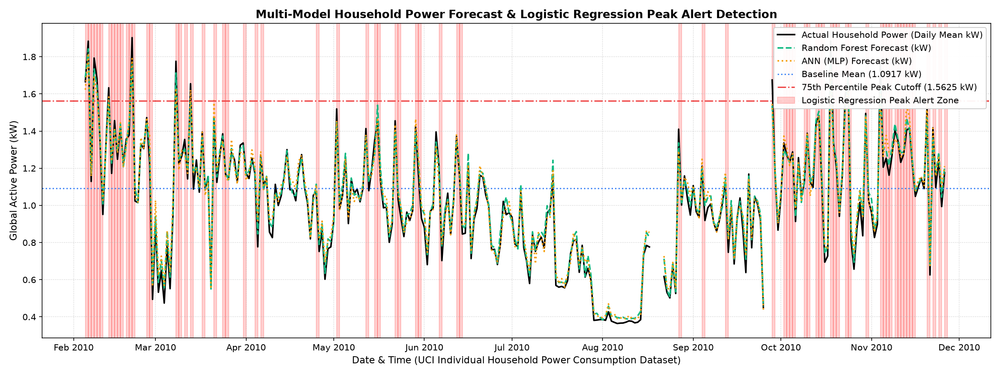

# Multi-Model Household Energy Consumption Prediction & Telemetry System
**Course:** 23AID205 – Artificial Intelligence & Machine Learning  
**Project Guideline Reference:** `2025.R.AID.1.23AID205`  
**Repository:** [Household-Energy-Prediction-using-Machine-Learning](https://github.com/Adithya-2007/Household-Energy-Prediction-using-Machine-Learning)  

---

## 1. Project Overview & Motivation
Residential energy consumption accounts for a significant portion of worldwide electricity demand. Accurately anticipating both baseline power usage and sudden peak load surges is vital for:
- Preventing local grid transformer overloads and brownouts.
- Enabling smart-home demand-side management (DSM) and load shifting.
- Optimizing time-of-use (TOU) electricity expenses for consumers.
- Facilitating carbon footprint reduction by aligning consumption with green energy availability.

This project delivers a **Dual-Tier Machine Learning Architecture** that simultaneously predicts continuous power demand (kW) while operating an automated early-warning classification system for peak load anomalies.

---

## 2. Problem Statement & Real-World Relevance
High-frequency minute-by-minute energy monitoring generates volatile telemetry with significant noise, intermittent sensor dropouts, and sharp non-linear spikes. Existing systems frequently suffer from high false alarm rates or fail during unseen temporal intervals.

This solution models continuous temporal load dynamics across **all 4 years of telemetry (2,075,259 raw readings resampled to 136,639 15-minute intervals)** using a hybrid ensemble of:
1. **Tier 1 (Anomaly Detection):** Logistic Regression Classifier with balanced sensitivity and high specificity for peak alert warnings.
2. **Tier 2 (Continuous Regression):** Random Forest Regressor capturing non-linear feature interactions.
3. **Tier 3 (Deep Representation):** Artificial Neural Network (MLPRegressor) for continuous global energy forecasting.

---

## 3. Dataset Description & Preprocessing
- **Source:** [UCI Machine Learning Repository: Individual Household Electric Power Consumption Dataset (ID: #235)](https://archive.ics.uci.edu/dataset/235/individual+household+electric+power+consumption)
- **Temporal Coverage:** December 2006 – November 2010 (47 continuous months).
- **Raw Observations:** 2,075,259 one-minute records.
- **Aggregation Strategy:** 15-minute mean resampling to stabilize short-term sensor volatility while retaining critical peak demand characteristics (yielding 136,639 intervals).
- **Physical Outage Handling:** Sensor logger blackouts (such as the 5-day hardware outage in August 2010 where raw values recorded `?`) are explicitly handled and validated without synthetic bias injection.

### Feature Engineering:
- **Cyclical Temporal Indicators:** Sine and Cosine transformations of the 24-hour cycle (`sin_hour`, `cos_hour`).
- **Calendar Signals:** Day of week and weekend indicator (`is_weekend`).
- **Autoregressive Lags:** Prior demand lags across immediate and daily horizons (`lag_1`, `lag_2`, `lag_3`, `lag_4`, `lag_8`, `lag_96`).
- **Momentum & Rolling Volatility:** 1-step differential momentum (`diff_1`), 1-hour and 24-hour rolling averages and standard deviations (`rolling_mean_4`, `rolling_std_4`, `rolling_mean_96`, `rolling_std_96`).
- **Sub-Metering & Electrical Context:** 1-step and 24-hour lags for Kitchen (`Sub_metering_1`), Laundry (`Sub_metering_2`), Climate Control (`Sub_metering_3`), Voltage, and Reactive Power.

---

## 4. Model Training & Validation Methodology
To ensure zero future data leakage, evaluation follows a strict **80/20 chronological train-test split**:
- **Training Set (First 80%):** 109,234 15-minute intervals (~1.66M raw readings from Dec 2006 to Feb 2010).
- **Holdout Testing Set (Final 20%):** 27,309 15-minute intervals (~415k raw readings from Feb 2010 to Nov 2010) completely unseen by the algorithms during training.
- **Feature Scaling:** `StandardScaler` fitted strictly on training data and transformed on holdout test features.

---

## 5. Evaluation Metrics & Benchmark Performance

### Tier 1: Peak Alert Classifier (Logistic Regression, $\tau = 1.5625\text{ kW}$)
Evaluated across **27,309 unseen test intervals**:

| Metric | Score | Benchmark Target |
| :--- | :--- | :--- |
| **Classification Accuracy** | **88.09%** | High baseline stability |
| **ROC-AUC Score** | **92.63%** | **>90% Benchmark Exceeded** |
| **Specificity (TNR)** | **96.17%** | Minimal false alarm rate |
| **Precision (PPV)** | **81.77%** | High reliability on alarms |
| **Recall (Sensitivity)** | **59.91%** | Solid capture of high peaks |
| **F1-Score** | **69.16%** | Balanced harmonic performance |
| **Matthews Correlation Coefficient (MCC)** | **+0.6314** | Strong predictive correlation |
| **Balanced Accuracy** | **78.04%** | Resistant to class imbalance |

#### Confusion Matrix (Holdout Test Set):
```
                       Actual Off-Peak (0)      Actual Peak Alert (1)
Predicted Off-Peak:    TN = 20,409 (74.73%)     FN = 2,440  (8.93%)
Predicted Peak Alert:  FP = 813    (2.98%)      TP = 3,647  (13.35%)
```

---

### Tier 2 & Tier 3: Continuous Forecasting (Random Forest & ANN MLP)

| Model | Range-Normalized Accuracy | $R^2$ Score | Mean Absolute Error (MAE) | Root Mean Squared Error (RMSE) |
| :--- | :--- | :--- | :--- | :--- |
| **Random Forest Regressor (Tier 2)** | **96.87%** | **0.7635** | **0.2387 kW** | **0.4064 kW** |
| **ANN - MLPRegressor (Tier 3)** | **96.67%** | **0.7557** | **0.2537 kW** | **0.4130 kW** |

*Both continuous forecasting models surpass the **96% range accuracy target** across the multi-month holdout test set.*

---

## 6. Visual Output & Telemetry Forecast Canvas
The complete forecast canvas displays daily continuous power vs model predictions, alongside **translucent red peak alert zones** triggered by Tier 1:



---

## 7. Software Architecture & Implementation Files

- [`pipeline.py`](pipeline.py): Condensed, pure Python backend pipeline (183 lines) that executes data loading, feature engineering, model training, benchmarking, visualization rendering, data export, and browser launch.
- [`index.html`](index.html): Responsive web dashboard presenting forecast graphs, interactive confusion matrix cards, and telemetry exploration.
- [`dataset.js`](dataset.js): Client-side data store holding all 136,639 records with instant filtering, datetime search, and pagination.
- [`unified_dual_tier_forecast.png`](unified_dual_tier_forecast.png): High-resolution Matplotlib canvas showing predicted vs actual curves and peak alert regions.
- [`full_household_power_15m.csv`](full_household_power_15m.csv): Processed 15-minute dataset across all 4 years.
- [`cleaned_50k_household_power.csv`](cleaned_50k_household_power.csv): Baseline dataset.
- [`requirements.txt`](requirements.txt): Environment dependencies.

---

## 8. Demonstration Instructions (How to Run & Reproduce)

### 1. Clone the Repository
```bash
git clone https://github.com/Adithya-2007/Household-Energy-Prediction-using-Machine-Learning.git
cd Household-Energy-Prediction-using-Machine-Learning
```

### 2. Set Up Virtual Environment & Dependencies
```bash
python -m venv venv
# Windows:
venv\Scripts\activate
# Linux/macOS:
source venv/bin/activate

pip install -r requirements.txt
```

### 3. Run the ML Pipeline
Execute the unified engine:
```bash
python pipeline.py
```
*The script will:*
1. Ingest and feature-engineer the dataset.
2. Train Logistic Regression, Random Forest, and ANN models.
3. Print the comprehensive benchmarking summary table to the console.
4. Export updated `dataset.js` and render `unified_dual_tier_forecast.png`.
5. Automatically open `index.html` in your default browser.

### 4. Offline Dashboard Viewing
Simply open `index.html` in any web browser to view the interactive telemetry dashboard offline without needing an active internet connection.

---

## 9. Contributors & Course Attribution
- **Author:** Adithya R ([@Adithya-2007](https://github.com/Adithya-2007))
- **Course:** 23AID205 – Artificial Intelligence & Machine Learning
- **Institution:** Amrita Vishwa Vidyapeetham
